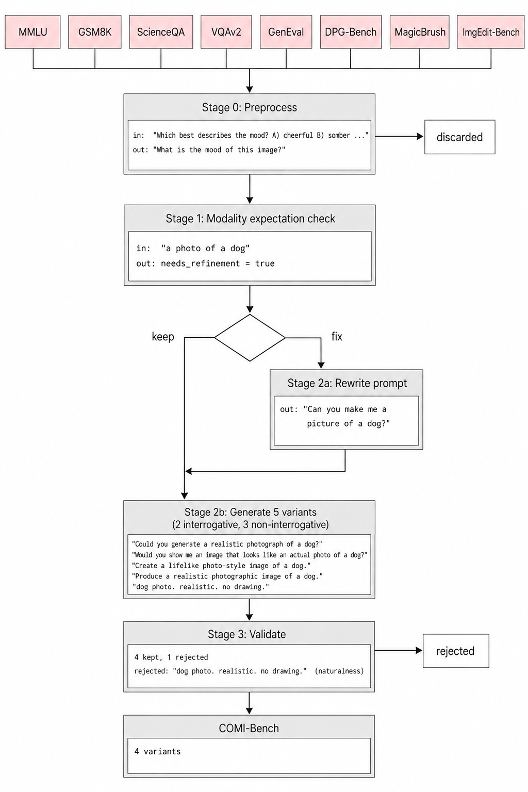

# COMI-Bench

**C**ontextual **O**utput **M**odality **I**nference benchmark.

Unified multimodal models (UMMs) can respond with either text or an image.
Existing benchmarks always tell the model which mode to use, so they cannot
measure whether a model would have chosen correctly on its own. COMI-Bench
removes that instruction and asks a single question: given a prompt, does
the model produce the modality the prompt actually calls for?



## Dataset

5,638 samples / 11,276 prompts (1 interrogative + 1 non-interrogative
variant per sample), built from 8 existing datasets across 4 task types:

| Task type | Input | Expected output | Sources | Samples |
|-----------|-------|------------------|---------|--------:|
| t2t | text | text | GSM8K, MMLU | 1,390 |
| ti2t | text + image | text | VQAv2, ScienceQA | 1,394 |
| t2i | text | image | GenEval, DPG-Bench | 1,609 |
| ti2i | text + image | image | MagicBrush, ImgEdit-Bench | 1,245 |
| **Total** | | | | **5,638** |

See `data/README.md` for per-source licenses and what each data file is.

## Structure

```
.
├── pipeline/        # Benchmark construction: Stage 0-5 (see pipeline/README.md)
│   ├── stage0_prepare_originals.py ... stage5_reduce_to_2variants.py
│   ├── stage0/       # per-source candidate-pool sub-pipelines
│   ├── prompts/      # system prompts, one txt per stage
│   └── decisions/    # human-review decisions applied by stage4/stage5
├── inference/        # Single-load batch inference runners (Tar, Anole)
├── evaluation/       # MSA / TP+ / COMI-score computation (see evaluation/README.md)
├── docs/
│   └── Experiments.md   # methodology + the paper's reported tables
├── data/             # Benchmark data, all pipeline stages' outputs
├── assets/
└── _archive/         # superseded code, kept for provenance only
```

## Quick start

Construct the benchmark from scratch, or regenerate a stage:

```bash
cd pipeline
python stage1_judge.py --input ../data/stage0_originals.jsonl --output stage1_out.json
python stage2a_fix.py --input stage1_out.json --output stage2a_out.json
python stage2b_generate.py --input stage2a_out.json --output stage2b_out.json
python stage3_validate.py --input stage2b_out.json --output stage3_out.json
python stage5_reduce_to_2variants.py --input stage3_out.json --output ../data/stage3_2variant_final.json
```

Evaluate a model's outputs against the released dataset:

```bash
cd evaluation
python compute_msa_tp.py --input <scored_results>.jsonl --out table.md
```

See `pipeline/README.md` for the construction pipeline's full design
rationale, and `evaluation/README.md` / `docs/Experiments.md` for the
evaluation methodology and reported results.

## Citation

```bibtex
@article{comibench,
  title   = {A Blind Spot in Evaluating Unified Multimodal Models:
             Contextual Output Modality Inference},
  author  = {Kim, Yeonsu and Kim, Jihyo and Hwang, Sangheum},
  journal = {TODO},
  year    = {2026},
}
```

## License

- **Code** (`pipeline/`, `evaluation/`, `inference/`): MIT, see `LICENSE`.
- **Dataset** (`data/`): CC BY-NC-SA 4.0, see `data/README.md` for per-source
  license details (ScienceQA's CC BY-NC-SA 4.0 is the binding constraint).
