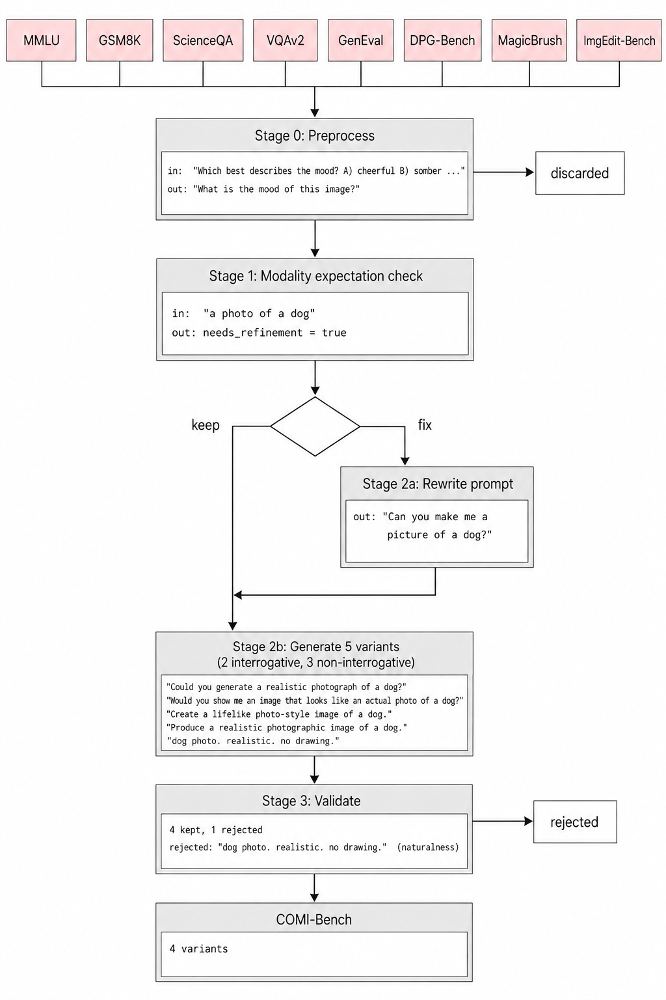

# COMI-Bench

**C**ontextual **O**utput **M**odality **I**nference benchmark.

Unified multimodal models (UMMs) can respond with either text or an image.
Existing benchmarks always tell the model which mode to use, so they cannot
measure whether a model would have chosen correctly on its own. COMI-Bench
removes that instruction and asks a single question: given a prompt, does the
model produce the modality the prompt actually calls for?

The benchmark covers four task types — T2T, TI2T, T2I, TI2I — built from
existing datasets with minimal refinement.



## Why existing data cannot be used as is

Prompts in text-to-image datasets are typically bare captions (`a photo of a
dog`) or statements of a desired result (`the sky should be clearer`). These
read as image requests only by convention of the dataset they came from. A UMM
can always continue in text, so on their own such prompts do not settle what
the model should do — and scoring a text continuation as wrong would be unfair.

A second problem is surface form. In source datasets, question marks correlate
almost perfectly with the text modality: VQA prompts are questions, image
prompts are not. A model could score well by looking at punctuation alone. The
construction pipeline controls for this.

## Pipeline

| Stage | What it does | Applies to |
|---|---|---|
| 0 | Preprocess: strip MCQ options, drop image-independent TI samples | subset of sources |
| 1 | Judge whether the prompt leads to its ground-truth modality | all |
| 1.5 | Gate: `keep` or `fix` (code, no LLM call) | all |
| 2a | Rewrite prompts that failed Stage 1 | `fix` only |
| 2b | Generate 5 variants (2 interrogative, 3 non-interrogative) | all |
| 3 | Validate each variant on modality / meaning / naturalness | all |
| 5 | Reduce 5 variants to 2 (1 interrogative + 1 non-interrogative); human review for samples that can't be reduced mechanically | all |

Stage 1 does not produce repair instructions. Its judgement criterion would
become the prescription, and every image prompt would end up rewritten as
"Generate an image: …". Stage 2a follows a fixed rewriting policy instead.

ScienceQA's MCQ-option stripping (Stage 0's job per the table above) is not
done inside `stage0_prepare_originals.py` itself -- it's applied as a
post-process directly on `data/stage3_2variant_final.json`'s ScienceQA rows.
See `pipeline/stage0/scienceqa_openstyle/README.md` for the conversion and an
important validation-coverage caveat (only 60/409 items went through real
Stage-3-equivalent LLM validation).

There is also a `stage4_finalize.py`, an earlier human-curation path (apply
per-sample drop decisions to the 5-variant Stage 3 output) that predates
Stage 5. **It is not part of the path that produced the released dataset.**
Stage 5 runs directly on Stage 3's output and does its own, separate human
review (see Human verification). `stage4_finalize.py` and its decision files
are kept for reference only; nothing downstream reads its output.

## Layout

```
pipeline/
  stage0_prepare_originals.py    Stage 0: assemble data/stage0_originals.jsonl from data/stage0_inputs/
  stage0/                        sub-pipelines that produce data/stage0_inputs/ (see stage0/README.md)
  stage1_judge.py                Stage 1 only
  stage2a_fix.py                 Stage 2a only (rewrite `fix`-routed prompts)
  stage2b_generate.py            Stage 2b only (generate 5 variants)
  stage3_validate.py             Stage 3 only (validate variants, per-variant or --batch-by-sample)
  stage5_reduce_to_2variants.py  Stage 5: reduce 5 variants to 2, human review for the rest
  stage4_finalize.py             earlier, unused curation path -- see Pipeline section above
  stage2_pipeline.py             superseded combined 2a+2b+3 script, kept for history; not used for the released data
  prompts/                       system prompts, one txt per stage
  decisions/                     per-sample drop/keep decisions (see Human verification)
  logs/                          full-run logs, one per stage (stage1/2a/2b/3 only)
data/
  stage0_originals.jsonl       Stage 0 output, input to Stage 1
  stage1_full_5682.json ... stage3_full_5682.json   per-stage outputs
  stage3_2variant_final.json   final released dataset (Stage 5 output)
assets/
  comi_pipeline.png
```

## Usage

```bash
pip install openai python-dotenv
echo 'OPENAI_API_KEY=sk-...' > .env

cd pipeline
python stage1_judge.py --input ../data/stage0_originals.jsonl --output stage1_out.json
python stage2a_fix.py --input stage1_out.json --output stage2a_out.json
python stage2b_generate.py --input stage2a_out.json --output stage2b_out.json
python stage3_validate.py --input stage2b_out.json --output stage3_out.json
python stage5_reduce_to_2variants.py --input stage3_out.json --output ../data/stage3_2variant_final.json
```

Models are set through environment variables. The validator is deliberately a
different model from the generator (Panickssery et al., NeurIPS 2024).

```bash
JUDGE_MODEL=gpt-5.5 GEN_MODEL=gpt-5.5 VAL_MODEL=gpt-5.5 python stage1_judge.py ...
```

System prompts live in `prompts/` as plain text so they can be edited without
touching the scripts. `PROMPT_DIR` overrides the location.

### Input format

```json
{"id": "t2i_007", "prompt": "an astronaut riding a horse on Mars", "task": "T2I", "source": "DrawBench"}
```

`task` is one of `T2T`, `TI2T`, `T2I`, `TI2I`. Ground-truth modality and input
image presence are derived from it.

## What to check in the output

- **`gate_per_task`** — bare captions and bare goal states should route to
  `fix`; explicit directives and plain VQA should stay `keep`.
- **`interrogative_ratio_by_modality`** — text and image should be close. A gap
  means question marks still predict the answer.
- **`axis_fail_rate`** and **`fail_combinations`** — which of the three
  validation checks is doing the rejecting.
- **`pass_rate_by_route`** — a low rate on `fix` points at Stage 2a; a low rate
  on `keep` points at Stage 2b.

## Human verification

LLM judgements are spot-checked by hand: Stage 1 decisions for agreement with
human labels, and a sample of Stage 3 survivors for meaning preservation.
Details in the paper.

**Stage 5's human review (this is what produced the released dataset).**
`stage5_reduce_to_2variants.py` picks 1 passed interrogative + 1 passed
non-interrogative variant per sample automatically wherever possible
(`random.Random(42)`, see the script). A sample can't be reduced this way if
all 5 variants failed Stage 3, or if no variant in one of the two slots
passed. Running the script against the released `data/stage3_full_5682.json`
and `pipeline/decisions/variant2_reduction_*.json`:

- **74** samples needed inspection (33 all-failed, 23 no non-interrogative
  survivor, 18 no interrogative survivor).
- Of those, **30** were rescued by hand (`variant2_reduction_manual_decisions.json`,
  `decision: "rescue"`, a specific pair of variants picked manually) and
  **44** were dropped (25 via the automatic drop registry
  `variant2_reduction_auto_drop_registry.json` for failure patterns with a
  single clear cause across many samples, the rest via explicit manual
  `"drop"` decisions — manual decisions always take priority over the
  registry).
- 5,682 → 5,638 samples (11,276 prompts).

**Stage 4's human review (superseded, not part of the released path).**
`pipeline/stage4_finalize.py` is an earlier, separate curation pass over the
same `data/stage3_full_5682.json`, driven by its own decision files
(`pipeline/decisions/drop_decisions.json`, `qa_decisions.json`; one row per
sample: `keep`, `drop`, or `keep` with a specific list of variants to drop).
Its two failure patterns:

- **Rule-based-graded sources** (`gsm8k`, `mmlu`, `ScienceQA`, `VQAv2`) reuse a
  single fixed `gold_answer` across all 5 variants of a sample. A variant that
  quietly changes a quantity or relationship in the source problem (e.g. "2
  more than he has" → "short by 2") silently invalidates that gold answer —
  unlike model-judged sources (`ImgEditBench`, `MagicBrush`, `dpg_bench`,
  `geneval`), where a judge scores the actual output against whatever was
  asked, so prompt drift there doesn't break grading the same way.
- **Source-level defects** independent of the variant step: duplicated text in
  the original prompt, and a couple of `ImgEditBench` items whose source
  prompt asked for a text answer despite being labeled `TI2I`.

Running `stage4_finalize.py` against the current decision files: 36 samples
reviewed, 7 dropped outright, 25 variants dropped across 17 other samples,
5,682 → 5,675. **This output (`data/stage3_final_5675.json`) is not present
in the repo and nothing downstream reads it** — Stage 5 was run directly on
`data/stage3_full_5682.json` instead, and the dataset it produced is what was
released. `stage4_finalize.py` is kept only so this history stays legible;
treat the numbers in this subsection as historical, not as a description of
the released dataset.

## References

- Panickssery et al. *LLM Evaluators Recognize and Favor Their Own
  Generations.* NeurIPS 2024.
- Mizrahi et al. *State of What Art? A Call for Multi-Prompt LLM Evaluation.*
  TACL 2024.
- Chen et al. *Are We on the Right Way for Evaluating Large Vision-Language
  Models?* (MMStar) NeurIPS 2024.
- Wang et al. *MMLU-Pro.* NeurIPS 2024 Datasets and Benchmarks.
